# Dodging Infinity

**AI orchestration and mission control for agents. A living world for the teams doing the work.**

[](#inside-the-engineering-team) [](#3-connect-grok-bot) [](#a-living-world-for-your-mission-teams) [](#built-through-real-work) [](https://github.com/TheMickeyDodger/dodging-infinity/blob/main/LICENSE)

[Why DI](#why-dodging-infinity) · [How it works](#from-request-to-reviewed-delivery) · [Real work](#built-through-real-work) · [The visual world](#a-living-world-for-your-mission-teams) · [Get started](#get-started) · [Where DI is going](#where-di-is-going) · [Documentation](#documentation)

Dodging Infinity turns complex work into **Missions**: persistent records of the objective, approvals, progress, evidence, and results. It coordinates AI engineering teams through Herdr and gives you a clear way to direct the work, inspect what happened, and decide what gets delivered.

Start a Mission from your phone through **Grok Bot**, monitor it, update the work, review the result, and authorize commits and pushes. That workflow has been verified end to end. Codex provides the Outer Operator, Dodging Infinity manages the Mission and Runtime, and Herdr carries out the engineering.

And the team has a place you can explore. The **Pixel Agents DI office** turns observed Mission teams into selectable characters inside a living metropolis, with working offices, forests, a waterfront, a cathedral quarter, and a subway. Select an agent, inspect its Mission, and see the work in context. An office you deliberately configure for it can also take an in-world request, the optional [Codex Orchestrator](#an-optional-in-world-request-the-codex-orchestrator). After setup, open the running office by typing **`pixel`** in your terminal.


*The running DI world. The inspector connects the scene to recorded Missions, agents, and engineering activity.*

## Why Dodging Infinity

The work I want AI to help with can stretch across many sessions, repositories, tools, and rounds of review. A scientific investigation can lead into molecular modeling, method selection, source-code analysis, and a decision about what should run next. A quantum-software bug can cross library boundaries before the correct fix reaches an upstream maintainer.

That work needs continuity. The objective should stay clear. Decisions should remain attached to the work they authorize. Findings should retain their sources. A completed implementation should arrive with something you can inspect.

I built Dodging Infinity to carry that whole process as a Mission, from the initial request through execution, review, verification, and delivery. Its design has been exercised through computational mechanosynthesis research, scientific-software contributions, remote engineering workflows, and the development of its own visual world.

| What you get | What it means in practice |
|---|---|
| **Persistent Missions** | Objectives, revisions, approvals, progress, and evidence stay attached to the work across sessions. |
| **An engineering team** | Supervisor, Lead, Executor, and Reviewer have distinct responsibilities, with independent review built into the workflow. |
| **Remote operation** | Use Grok Bot to initiate Missions, monitor progress, request changes, inspect results, and carry approved work through commits and pushes. |
| **Inspectable results** | Review the implementation, test evidence, findings, and remaining questions against the Mission’s requirements. |
| **Clear delivery decisions** | Authorization to perform engineering work and authorization to deliver it are handled explicitly. |
| **A visual home** | Explore the office, select observed agents, switch Missions, and inspect the records behind the activity. An office configured for it can also take an in-world request (optional). |

## From request to reviewed delivery

A Mission carries the work through six steps:

1. **Describe the objective.** Explain the problem, target repository, constraints, and desired result.
2. **Review the proposed Mission.** The Operator turns the request into a scope you can inspect and approve.
3. **Launch the work.** DI’s Runtime advances the authorized workflow and hands engineering to Herdr.
4. **Stay involved.** Ask for progress, inspect blockers, and request updates. Changes to the approved scope receive their own decision.
5. **Review the result.** Herdr returns its work and review evidence; DI checks the result against the Mission’s requirements.
6. **Authorize delivery.** Commit and push the approved change through the delivery workflow, with the decision and outcome recorded.

### Current engineering workflow

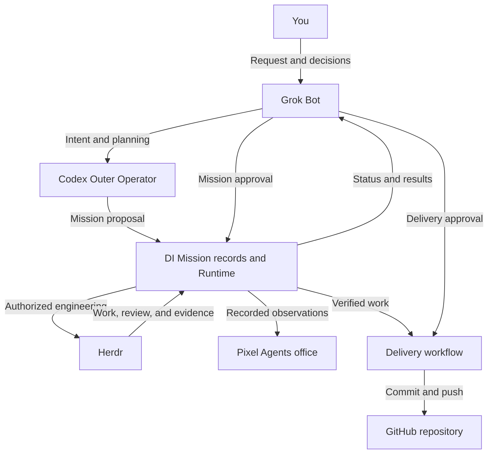

Grok Bot is the conversation interface. The Operator interprets the request. DI keeps the Mission’s state and advances its workflow. Herdr owns engineering execution. The office presents the recorded activity.

The same Mission remains the reference point as the work moves between these parts. The [target architecture](#target-architecture-one-mission-system) extends this foundation with Dots, shared attention, adaptive teams, and richer visual interaction.

### A conversation can carry the work forward

These are example requests you can make through the configured Grok interface:

**Start**

> Create a Mission for this repository. Investigate the failing export, identify the cause, add regression coverage, and propose the scope for my approval.

**Monitor**

> What is the team working on, what has been verified, and what needs a decision from me?

**Update**

> Add backward compatibility with the existing export format to the acceptance criteria. Show me the revised Mission before continuing with that change.

**Deliver**

> Show me the reviewed diff and verification results, then prepare the commit and push for my approval.

Progress and results can be requested while the host and its services remain available. Mission and delivery decisions stay attached to their specific scope.

## Built through real work

DI has been used on projects that require technical depth, sustained context, and careful review. These examples show the kinds of work that have shaped it.

### Computational mechanosynthesis

[**di-mechanosynthesis**](https://github.com/TheMickeyDodger/di-mechanosynthesis) investigates computational models of mechanically controlled carbon transfer at a silicon surface.

The work brings together literature analysis, molecular structure construction, computational chemistry, numerical validation, and reproducible provenance. DI has coordinated the preparation and review of atom-mapped donor candidates, a **409-atom tool–surface model**, study protocols, and an auditable research record. Independent review has driven corrections to method definitions and numerical acceptance criteria, while engine-validation work has led into source-level investigation.

The published work includes candidate geometries, reviewed research definitions, and documented validation attempts. Proposed structures and methods retain their scientific status throughout review; the repository distinguishes them from validated chemistry.

This is the continuity DI is built for: carrying the question, sources, models, evidence, and decisions through an extended research effort.

[Explore the research](https://github.com/TheMickeyDodger/di-mechanosynthesis) · [Study package](https://github.com/TheMickeyDodger/di-mechanosynthesis/tree/main/docs/ms-001) · [Structures](https://github.com/TheMickeyDodger/di-mechanosynthesis/tree/main/structures/ms-001) · [Evidence policy](https://github.com/TheMickeyDodger/di-mechanosynthesis/blob/main/docs/evidence-policy.md)

### Quantum software: a merged qBraid contribution

DI has also supported work on quantum software, including a [**merged qBraid SDK fix**](https://github.com/qBraid/qBraid/pull/1333) for converting Cirq reset operations into pyQuil.

Cirq circuits containing a reset could fail on the direct conversion path. The change adds the corresponding Quil `RESET` instruction while preserving the target qubit and operation order. Regression tests cover the conversion and explicitly reject unsupported resets on higher-dimensional systems.

The contribution passed upstream checks and was accepted and merged by a qBraid maintainer. It is a concrete example of taking a real defect through investigation, a focused implementation, verification, and upstream review.

| Project | Work carried through the process | Public result |
|---|---|---|
| **Computational mechanosynthesis** | Research planning, molecular models, method definitions, numerical criteria, provenance, and independent review | [Published research repository](https://github.com/TheMickeyDodger/di-mechanosynthesis) |
| **qBraid SDK** | Quantum-circuit conversion, reset semantics, regression tests, and upstream review | [Merged contribution](https://github.com/qBraid/qBraid/pull/1333) |
| **Pixel Agents DI office** | Mission catalog integration, selectable agents, observed state, and a connected visual world; with an optional, separately configured request panel (Codex Orchestrator) | [Integration and operating guide](https://github.com/TheMickeyDodger/dodging-infinity/blob/main/docs/pixel-agents-office.md) |

## Inside the engineering team


Herdr gives engineering work an explicit organization.

| Role | Responsibility |
|---|---|
| **Supervisor** | Understands the engineering objective, decomposes the work, and establishes its direction. |
| **Lead** | Coordinates execution, follows dependencies, and determines when the work is ready for closure. |
| **Executor** | Implements the change and runs the required checks. |
| **Reviewer** | Inspects the result independently and can return it for correction. |

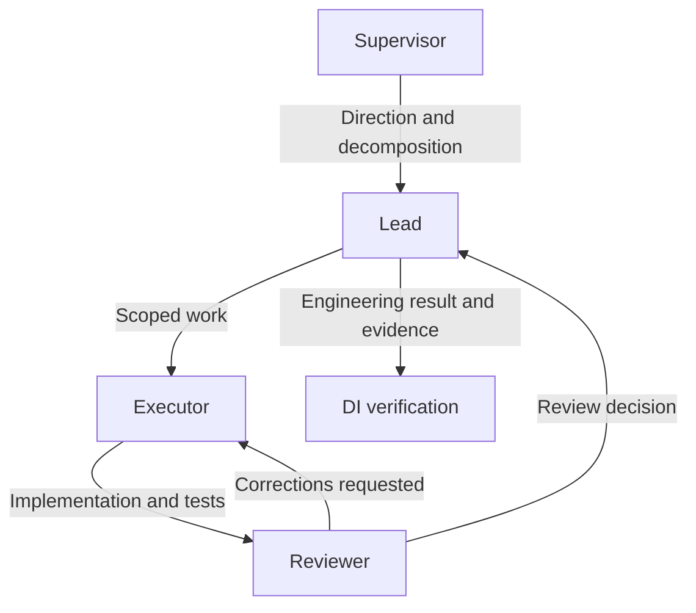

The Reviewer works independently from the implementation. DI then evaluates the engineering result within the larger Mission, including its approved scope and proof requirements. Delivery proceeds through its own authorization. These responsibilities also underpin the [planned adaptive team](#target-engineering-a-team-chosen-for-the-assignment), where qualified models are selected for individual assignments.

[Engineering architecture](https://github.com/TheMickeyDodger/dodging-infinity/blob/main/docs/architecture.md#8-engineering-herdr) · [Operator protocol](https://github.com/TheMickeyDodger/dodging-infinity/blob/main/OPERATOR_PROTOCOL.md)

## A living world for your Mission teams

The Pixel Agents DI office gives the system a place you can explore.

**Open your world with one command.** After [setup](#4-open-the-visual-office), with the office running:

```bash
pixel
```

Your default browser opens directly to the office. You can run the command from any directory.

The original palace opens into forests, mountain lakes, farms, a harbour, and a city of distinct districts. The **Botanical Atrium** and **Deco Observatory** add two more office complexes. A Gothic cathedral quarter, shops, cafés, galleries, and a subway connect the wider metropolis.


*The palace remains the home office, with connected workspaces and an observation deck leading into the forest.*

| Inside the office | Along the waterfront |
|---|---|
|  |  |
| Connected rooms, desks, galleries, and characters moving through the workplace. | A harbour district with cafés, landmarks, and a long oceanfront. |

| Grand offices and cathedral | River Valley Farmland |
|---|---|
|  |  |
| Two additional office complexes beside the cathedral and city destinations. | Countryside and river crossings extend the world beyond the city. |

The included living-metropolis preset spans **352 × 312 tiles**, with **145 decorative residents**, **four subway stations**, and **two trains**.

The **City** panel adds decoration only: day and night lighting, **seasons** (Automatic from summer, thirty minutes of the view running each, or one you hold) and **regional weather** (each region of the world changes its own weather every two to five minutes, or one choice for all of it). Offices stay lit and dry, labels and agents stay readable, and none of it says anything about what a Mission or an agent is doing. Reduced motion stops the weather particles and makes every change instant (the season and weather clocks keep running); a manual weather choice overrides the automatic rules everywhere. See [the living city](docs/pixel-agents-office.md#the-living-city-lighting-seasons-weather-traffic-residents-and-the-subway).


| Autumn Wildwood in the four seasons | River Valley Farmland in the four seasons |
|---|---|
| 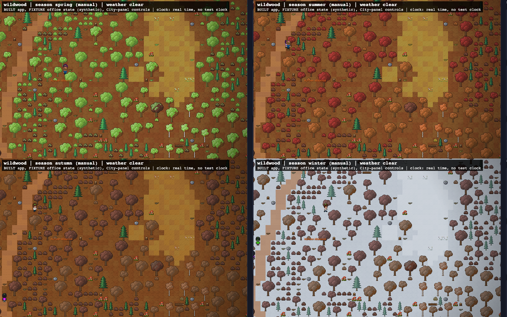 | 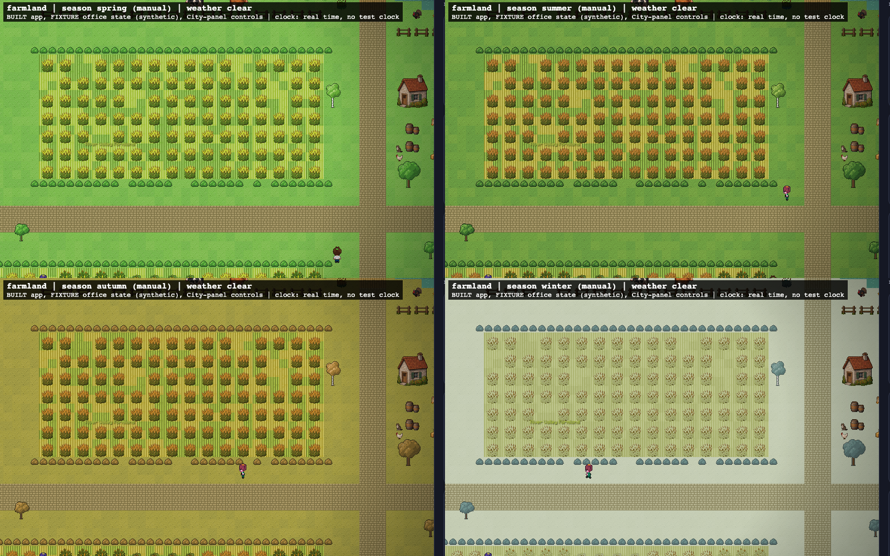 |
| Season held on each, weather Clear. Captions are the state the page reported. Built app, synthetic fixture office state, real time. | The same four seasons over crops, barns and fences. Built app, synthetic fixture office state, real time. |

| Light and heavy snow | Regional weather changing on its own |
|---|---|
| 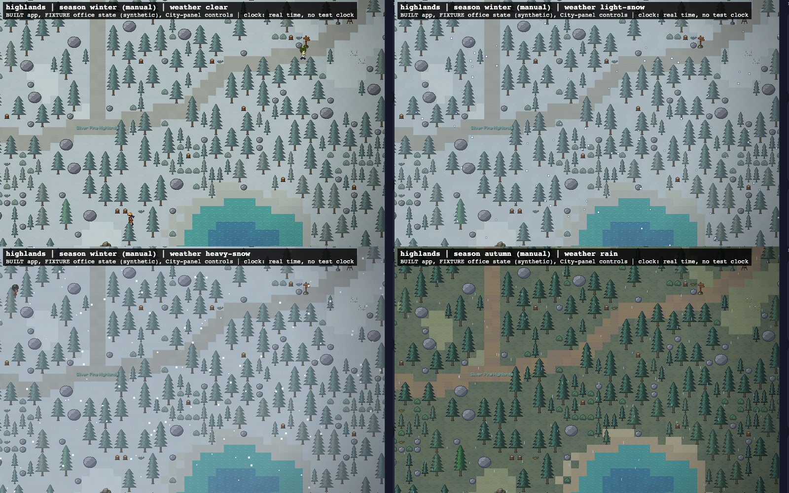 | 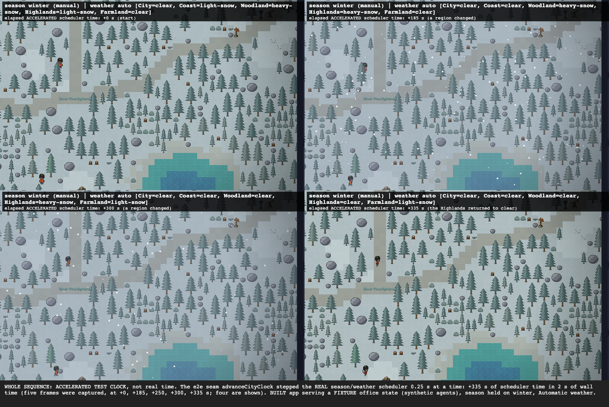 |
| Manual weather choices over the same ground. Built app, synthetic fixture office state, real time. | Automatic weather in a held winter, driven by the real scheduler on an **accelerated test clock**: +335 s of scheduler time in 2 s of wall time; each frame states its own elapsed time. Built app, synthetic fixture office state. |

| Two regions, two different weathers at once |
|---|
| 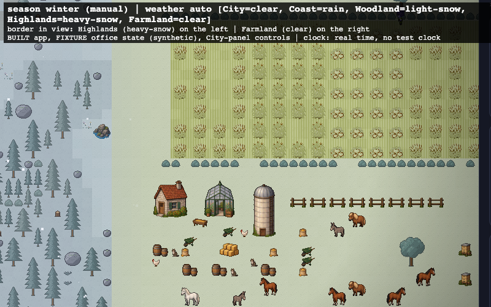 |
| Real time, no test clock: Automatic weather in a held winter on a fresh profile; the real seeded scheduler drew heavy snow for the Highlands and clear sky for Farmland at the same moment. Built app, synthetic fixture office state. A mild warm/cool seam remains at this border (Farmland keeps an olive-cream winter ground). |

These pictures are of a synthetic fixture and say nothing about live Missions or agents. Capture details, hashes and limits are in [`assets/pixel-world/seasons-and-weather.md`](assets/pixel-world/seasons-and-weather.md). Spring and summer look much alike where a district is mostly water, sand or paving (the Coast, the Harbour, much of the Metropolis).

### One Reception inbox, a receptionist, and agents in all three grand offices

The side panel's **Open reception** entry and the reception desk in the Palace lobby open the **same Reception inbox**: what needs you, in plain words, with the exact record one disclosure away. It draws on the catalog's source-qualified Mission observations, on delivery proposals if you opt in, and on the Mission request panel if you configure it. It says what each source covers, and a source it could not read is labelled as such, not shown as "none". The inbox is view only: nothing in it approves, starts or delivers anything, and a card that points to the request panel only opens it.

| The inbox: coverage lines, then cards | The decision the request panel also lists is one card |
|---|---|
| 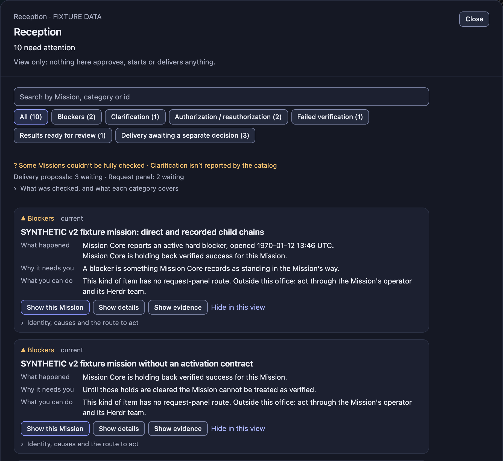 | 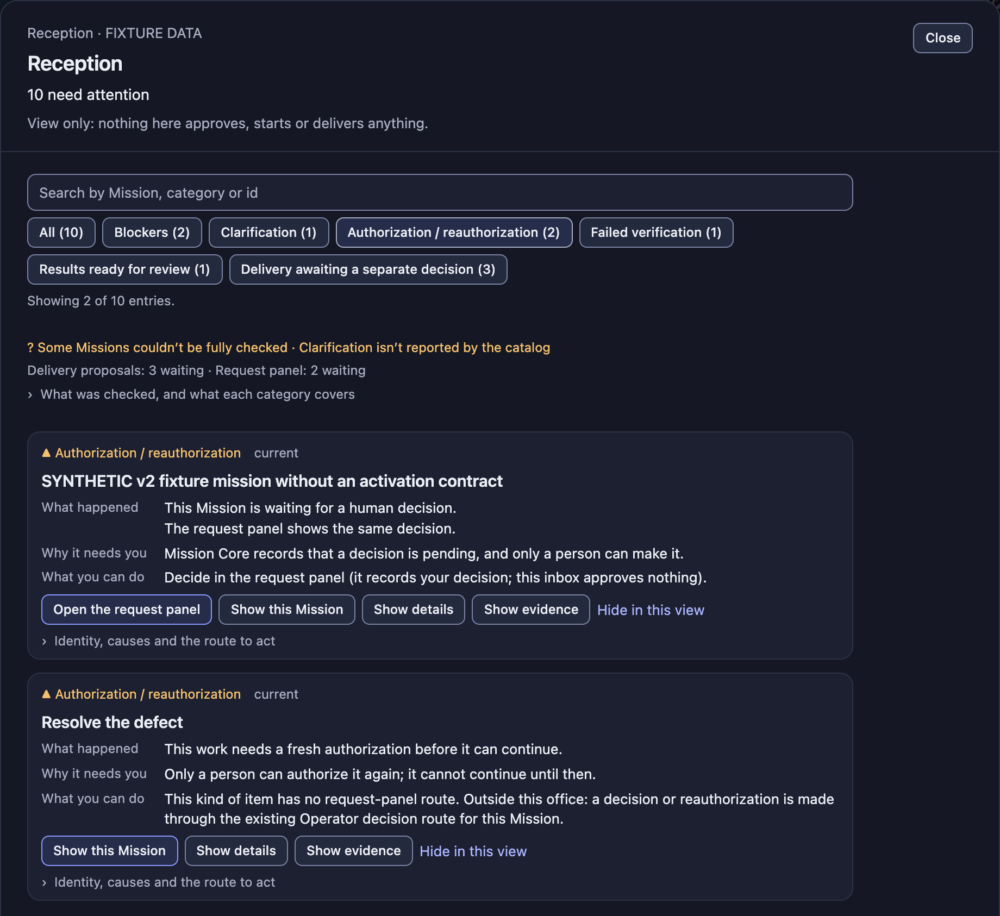 |
| Each card leads with plain sentences; identifiers and reason codes stay one disclosure away. | A decision that Mission Core and the request panel both report is one card. The inbox approves nothing; the panel records the decision. |

A **permanent, decorative receptionist** stands at the lobby desk under a "Reception" label that opens the same inbox. It is not a worker and has no authority.

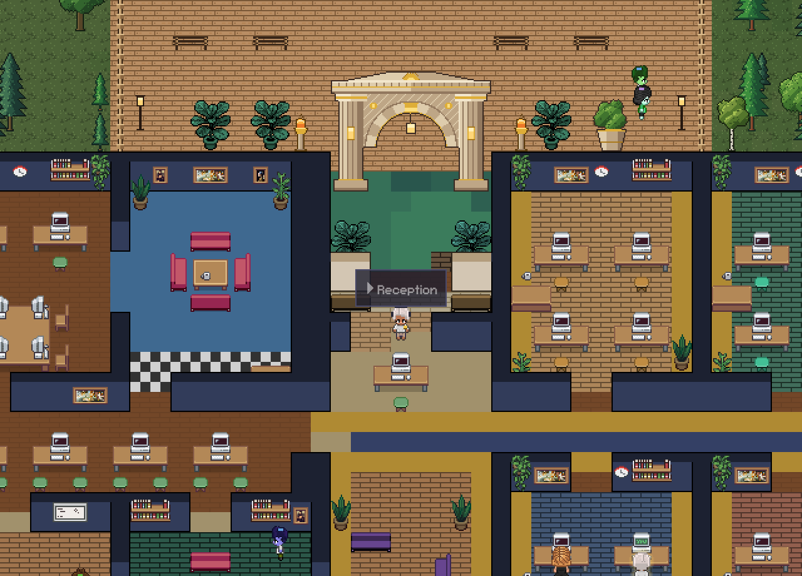

**Real agents are placed across the Palace, the Botanical Atrium and the Deco Observatory**, workstations first and team by team. A workstation is a reachable chair that faces a desk and a PC or monitor; the shipped world has 188 (44 in the Palace, 72 in each of the other two), and a bare meeting table or coffee table is not one. For a fresh placement, one four-agent Mission sits 2 / 1 / 1 and 39 agents in several teams sit 13 / 13 / 13, all on workstations. A seat an agent holds now, or that this build remembers for its identity, is kept even if it is a table seat. Agents whose seats were saved by an earlier build (by a per-run number) are placed once by the new rule and then remembered by identity. Each agent's seat is remembered by its identity across restarts for as long as that seat, the layout and the identity remain valid.

| Palace | Botanical Atrium | Deco Observatory |
|---|---|---|
|  |  | 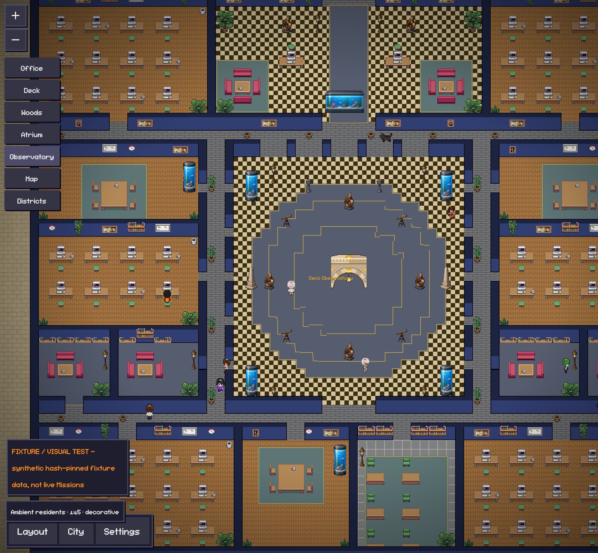 |
| One four-agent Mission: two here, at desks with PCs. | One here, at a desk with a PC. | One here, at a desk with a PC. |
| 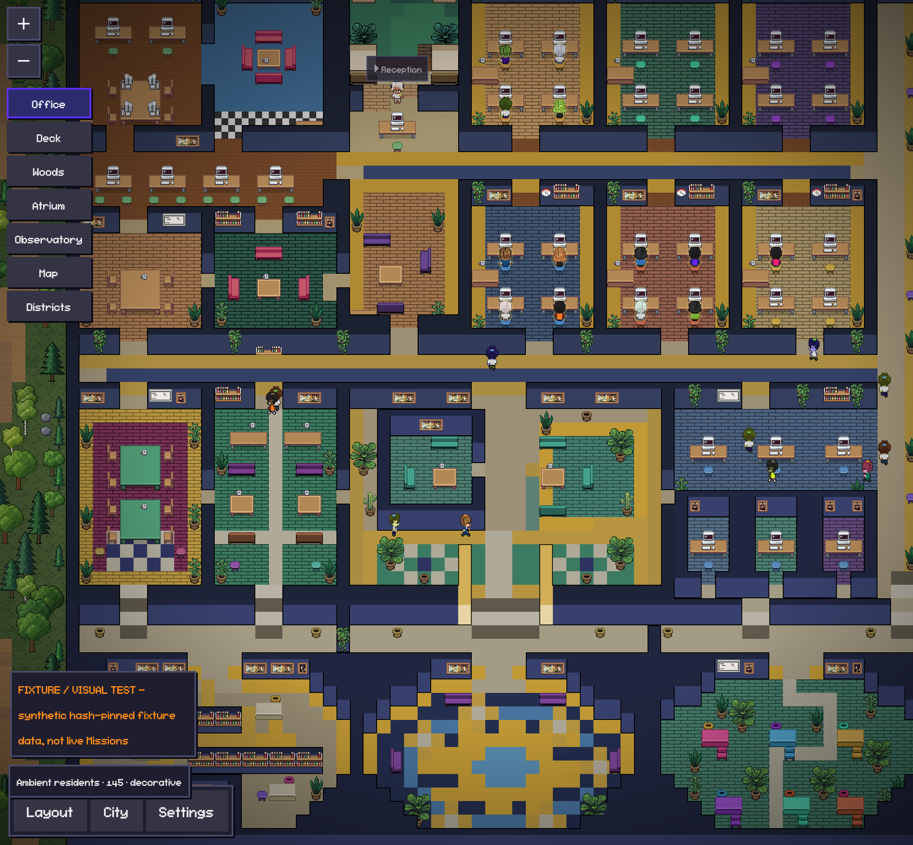 | 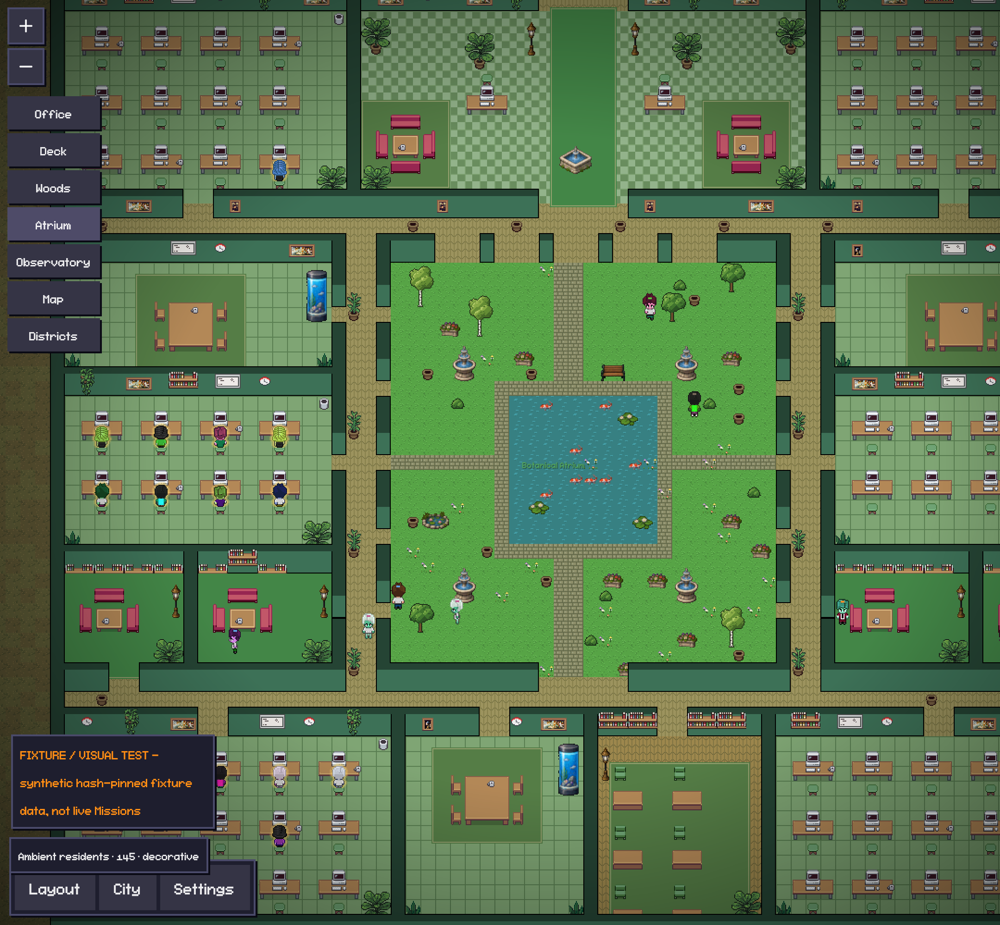 |  |
| 39 agents in several teams: 13 here. | 13 here. | 13 here. |

Each agent shown was checked, not assumed: the capture kept a picture only after observing every specified agent seated on its assigned seat tile at a workstation (a chair facing a desk and a PC), by exact fixture identity, with its sprite inside the frame. The per-agent seats are in the [provenance note](assets/pixel-world/reception-offices-provenance.md).

**Office interiors are calmer, and the offices keep visible life in their shared rooms.** Residents of the offices stop in the lobbies and corridors rather than at the desks, and only some of an office's roaming residents take the long walk across the city. Measured from where residents actually stand, against the previous build's resident plans reproduced on this engine, an office's shared rooms hold on average at least as many of its residents as the previous build had anywhere in the same office, and no resident was found standing in a work room at the sampled instants. The comparison table, its exact definitions and what it does not show are in the [office guide](docs/pixel-agents-office.md#world-preset). The residents of every other place are unchanged: their plans, looks and timers are pinned to the previous build's by test. The pictures below are a **supplemental time-lapse captured on an earlier build**, before the workstation correction; they show no agents, so seating cannot appear in them.

| | A few seconds after load | About 10 minutes after load | About 20 minutes after load |
|---|---|---|---|
| **Palace** | 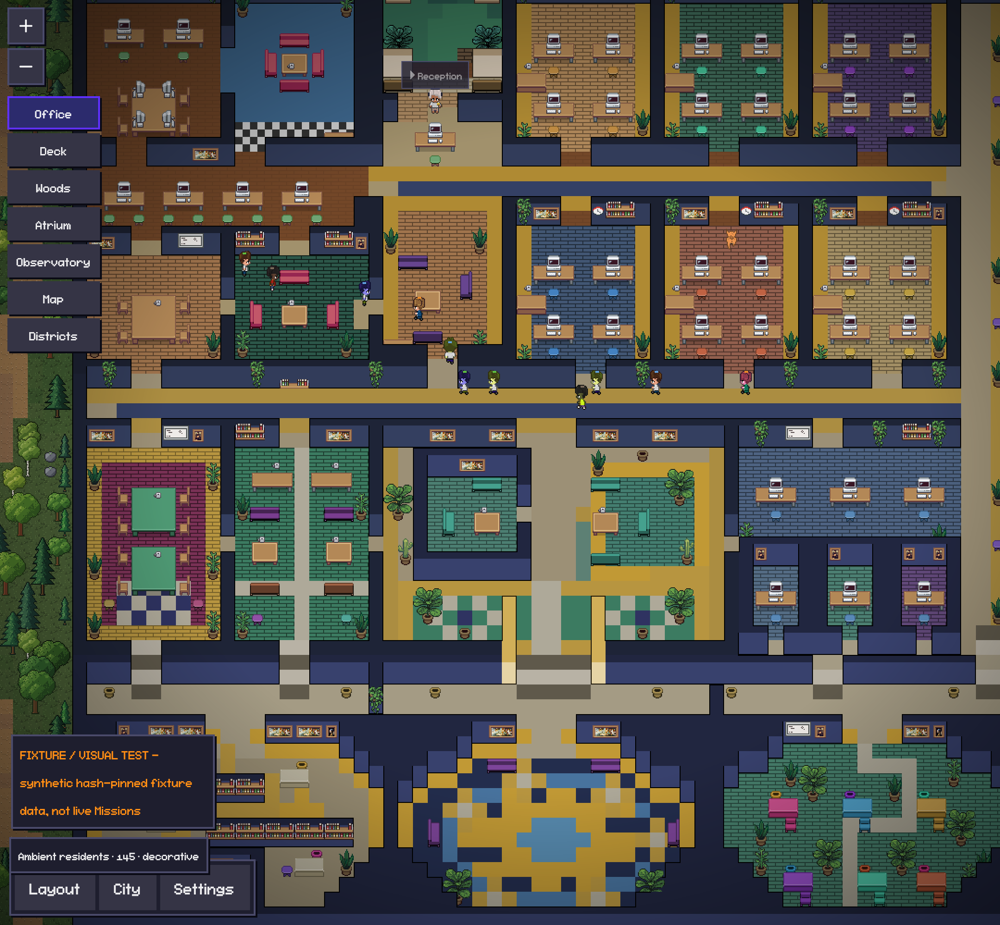 | 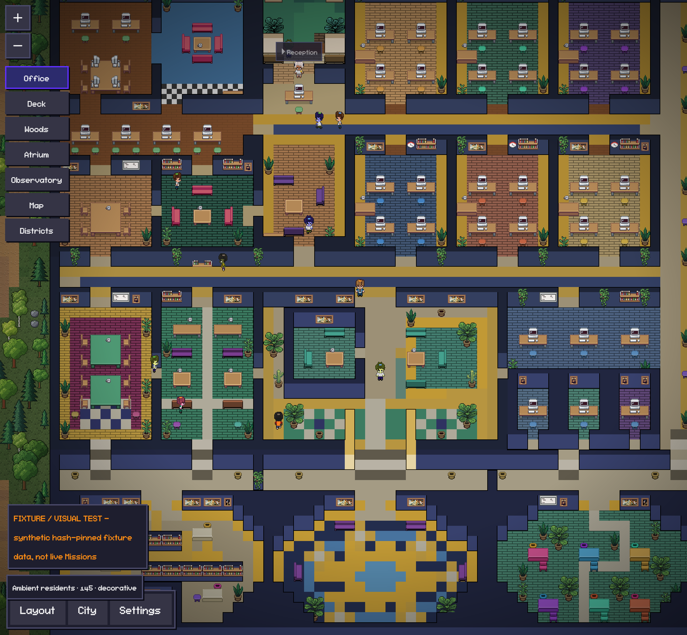 |  |
| **Botanical Atrium** | 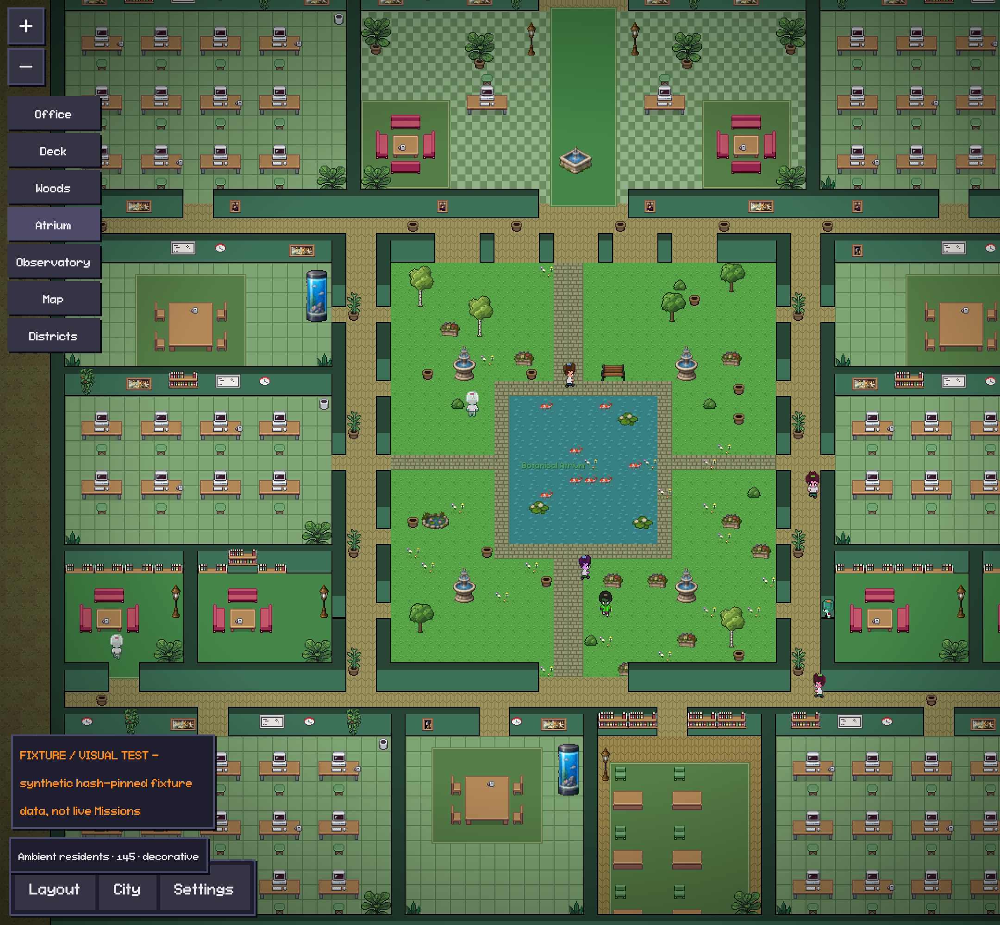 |  | 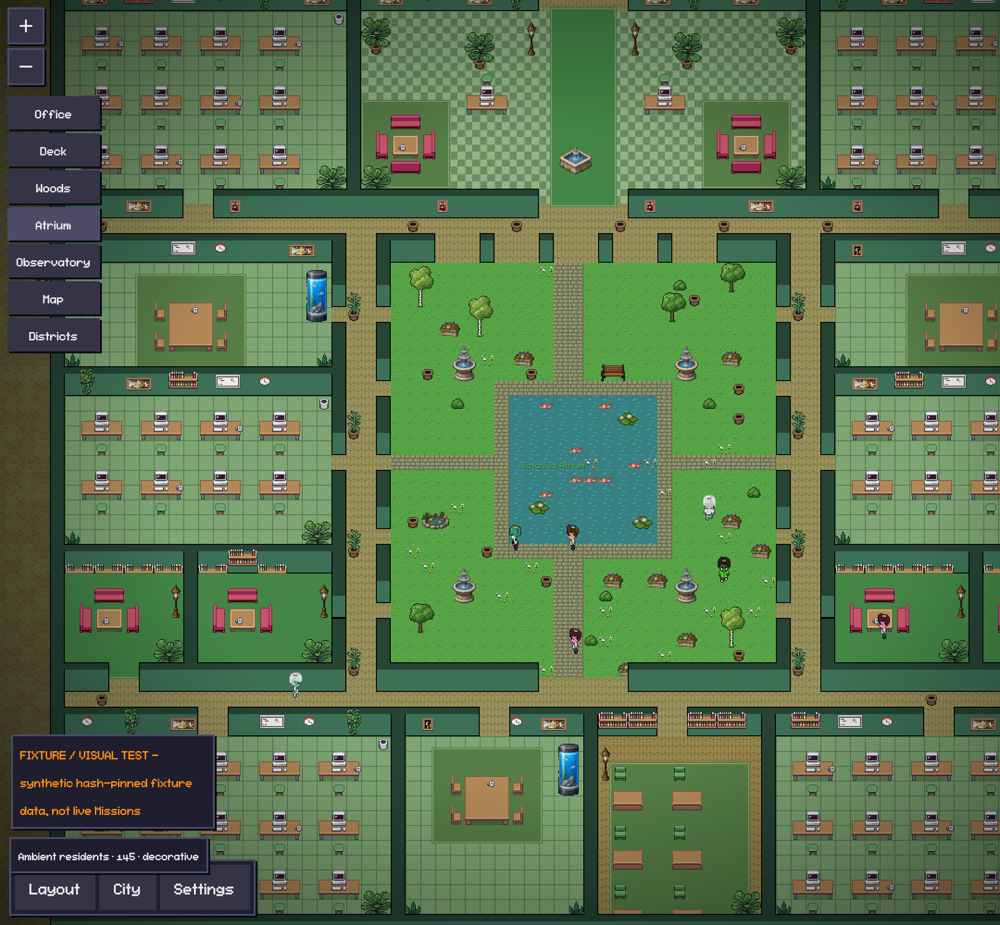 |
| **Deco Observatory** |  |  | 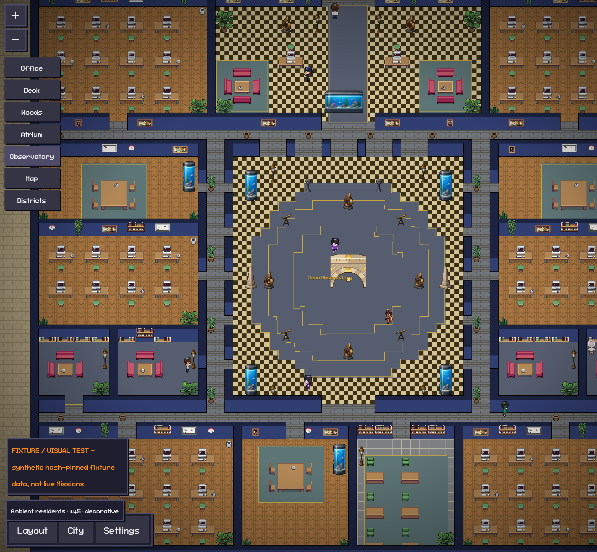 |

*Every picture in this subsection is synthetic: owned synthetic records through the real catalog bridge, with no live Mission work, captured in headless Chrome. The inbox, desk and agent pictures were captured from the final runtime's package; the zero-agent time-lapse above was captured on an earlier build and is supplemental. The time-lapse columns are wall-clock time after the page loaded, not simulated time, and each picture's exact elapsed seconds are in its alt text and in the provenance note. The inbox's placeholder blocker date (1970) is the synthetic fixture's. Which build each picture comes from is in the [provenance note](assets/pixel-world/reception-offices-provenance.md).*

### Teams show up without per-team setup, and their desks stay readable

The office needs no source configured for each team. After the one-time [task-source step](#4-open-the-visual-office) (`python3 dicatalog.py task-source --registry /absolute/path/to/office-catalog --ensure`), it shows the current verified roles of the teams working in the repositories you prepared with `herdctl init`, within the limits it discloses. A team can still be absent: its session may not bind, its records may be stale, a source may be refused or unreadable, or the runtime listing may be over its fixed capacity. When no team shows, the office's runtime-agents line says why in three situations. `Runtime agents: not_applicable (task_native_source_not_registered)` means no task source is registered, so run the step-4 command. `Runtime agents: not_applicable (task_native_sources_record_no_roles)` means the registered sources were read fresh and none of their repositories records a role, so there is nothing to show yet; the office's runtime evidence counts say how many repositories were read. Role records that could not be read are counted on their own (`roots_role_records_unreadable`) and are never reported as "record no roles".

A busy working office used to bury its real agents under decorative residents. The office now draws only some of a working office's residents at a time, the ones *on duty*, and says so in its legend (`Ambient residents · 4 on duty of 140 · decorative`). The rest are off duty: still simulated, with their ids, jobs, routines and saved positions unchanged, resting where they stand while residents take turns on duty, one hand-over every six seconds. In the default office (4 of 140 drawn) and in the expanded-office preset (16 of 140 drawn) that is an **actual reduction** in what is on screen. The Palace's 11 residents are below that bound, so every resident of the living metropolis is still drawn; where the offices' residents stand is a separate rule, described above.

| Default office: 4 of 140 residents on duty | Expanded office: 16 of 140 residents on duty |
|---|---|
| 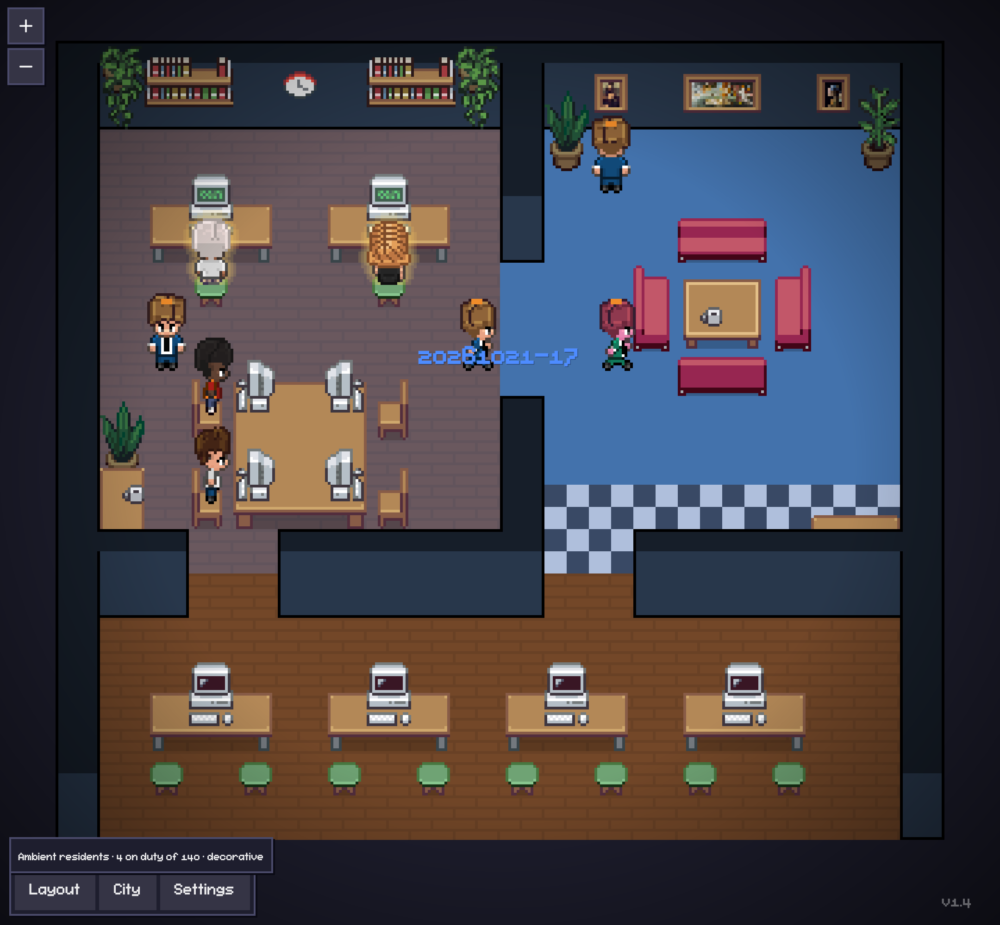 | 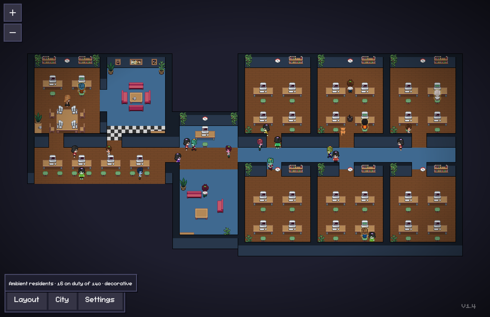 |
| One team of four agents; the busy ones glow at their desks. | Two teams of four agents across the connected rooms. |

*Both pictures are synthetic: owned synthetic records shown through the real catalog bridge (no substituted catalog), captured from the candidate build. They are not live Mission work, and the 140 residents of the first two offices are all still simulated; see the [provenance note](assets/pixel-world/team-discovery-provenance.md).*

### See the work behind the characters

- **Select an agent** to inspect its role, source, and associated Mission.
- **Switch Missions** in the side panel, and use **Show details** to follow available task chains and review records.
- **Recognize current activity** through the working-agent glow and visible freshness information.
- **Explore the world** with the map, district navigation, and camera controls.
- **Return to the office** and reconstruct the current recorded Mission observations.

Real agents come from DI’s Mission catalog. Ambient residents give the world its everyday life and are identified separately. An office that is simply running is a read-only view of recorded work; Mission commands and approvals remain in the operating interfaces unless you deliberately configure the optional request panel described below.

The screenshots above show the running local world. The living metropolis is an optional preset that can be imported into the office.

### A calm overview and a full-size details view

The side panel answers four questions at a glance: **what each Mission is for, how it is doing, who is on it, and what needs you.**

- **Needs attention comes first.** One line says how many items the Reception inbox lists, with **Open reception** to go to them. Under it, one plain sentence says what this view may not show (for example, kinds of attention this office does not report, or team members working in linked child tasks); the exact limits are listed with the attention items themselves. A configured **Codex Orchestrator** entry always sits right after it, in the same place whether nothing or twenty things need attention. Where the request panel is not set up, it is a single quiet notice with the reason and the setup steps behind it.
- **Each Mission card leads with its goal**: the objective's own first meaningful sentence, never a made-up summary. When an objective opens with only an id or a heading, the card says the objective text is there to read instead. Then comes its status, as a word and a shape rather than colour alone, and its team as observed: "4 of 4 members observed running · 4 terminals busy". *Observed running* is about the agents' processes; *terminal busy* is what each agent's own terminal reports. Neither is progress on the task. The card's actions say what you will see: **Show in the office**, **Show details**, and **Show evidence** where the office reports an evidence library for that Mission. A short source-qualified reference at the end of its status line tells look-alike Missions apart.
- **Other agents**, found running but listed by no Mission as a team member, are grouped by what the source establishes: *No current Mission* (an assignment record, not a sign that they are idle or free), *Task not confirmed*, *Assignment not recognised* (whether they have a task is unknown) and *Can't be linked to a role* (an agent with that name is running, but it cannot be safely linked to its recorded role, so it is not drawn). What a group shares, its reason and its activity, is said once. A row says only what differs, and every row names its root, so two agents with the same name stay apart.
- **The Selected dock** says where you are ("Agent 5 of 16 · Mission 2 of 2") and steps through agents or Missions with **Previous** and **Next**.

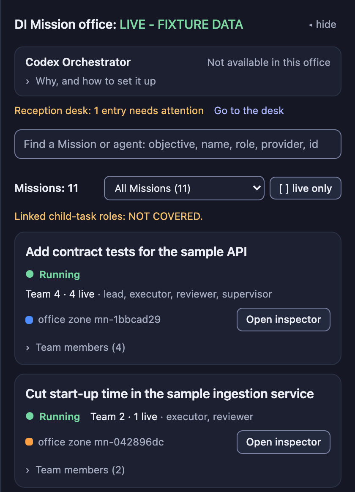

**Show details** opens a full-size, read-only view. It says first who or what this is, what its terminal reports right now, and which Mission it belongs to, with the actions that apply. Then comes the Mission's complete objective, exactly as its source exported it, followed by its team, checkpoints, evidence and review. Exact identities, reason codes, ISO times and epochs, and what the office does not report (model, usage, cost, progress, ETA) sit behind clearly labelled disclosures: one deliberate click away, never removed. It behaves as a dialog: focus moves in, Tab stays inside, and Escape or Close returns you to where you were.

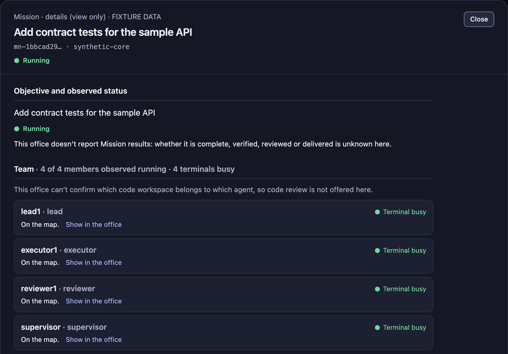

Both screenshots use synthetic test data, and the product says so in the frame (“LIVE - FIXTURE DATA”); how they were made is noted in [assets/pixel-world/operational-panel.md](assets/pixel-world/operational-panel.md). Status is what was observed, never assumed: unknown stays unknown rather than zero, a reported result is not shown as a verified one, and where a Mission's source exported no goal, such as a task row whose objective is only a section header, the panel says no goal was reported instead of inventing one. This is still a read-only view; it adds no new authority.

### An optional in-world request: the Codex Orchestrator

An office that is merely running and observing has **no** request or approval capability, and an existing or older setup does not gain one by upgrading. The office takes requests only when you deliberately **configure** it: you start the request panel and the progression runtime with the same state, control and workspace locations, and give the office the panel’s discovery file. Once configured, you can ask for work in ordinary words, read an exact proposal, give an exact human approval (an operator attestation, not verified human authorship), press an explicit Start, and then follow automatic, supervised progress to a retrievable verified result. Git delivery stays **separate and human-gated**: the panel does not commit, push, merge, or release.

**One workspace, matched to the side panel.** Ask and Requests open in a single workspace that uses the side panel's colours, type, lines and controls. It has a compact header, quiet tabs (the Requests tab carries a small chip that says what it counts, such as "1 request needs you") and ONE persistent context area under the tabs that cannot be dismissed. In a synthetic fixture office that area says so ("Conversation, proposals and results here are synthetic; no approval given here is real", with the full wording one disclosure away), and it says whether automatic progress is on or off, in one plain sentence with its own details. In Ask, turns are labelled **You** and **Assistant**; one note above the transcript says the assistant only drafts and carries no authority, and an older reply that contains a technical block shows its prose, a view-only note and its exact original behind a disclosure: it is never listed as a question and never counted. The open request leads with its **plain title**, then its **status and next step**; the request id, Mission, revision and digest sit together under **Exact references (technical)**; the proposal, its proof rules and the offer are shown in full (raw keys follow their plain words, muted), and the decision says exactly what approving binds to ("You are approving revision 1 of this proposal (digest c0d3e7669d69…)"). Nothing about who decides changed: opening, reading or resizing approves nothing, and approving still takes the typed word. The sidebar card's counts each name what they count: `1 request needs you · 1 conversation waiting for your answer · 1 request in all`.

| Ask | Requests |
|---|---|
| 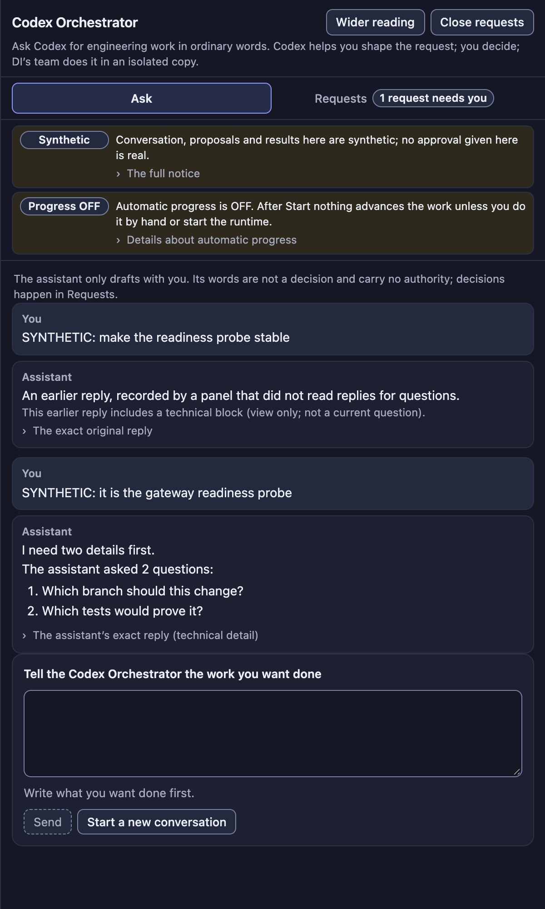 | 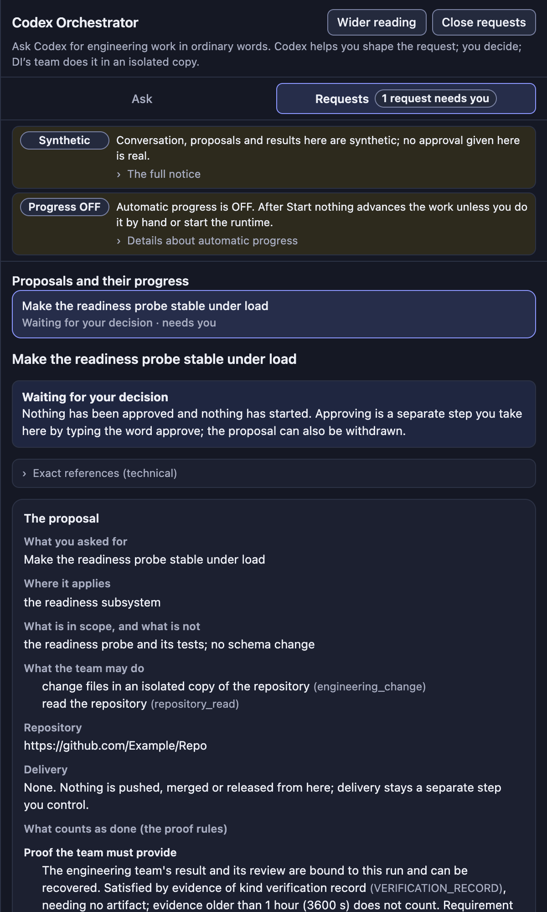 |
| Ask: an older reply's technical block is folded away (exact original one disclosure away); the current reply's questions are a numbered list. | Requests: the open request leads with its title, status and next step; the exact references are one disclosure. |

| Wider reading | The sidebar card |
|---|---|
| 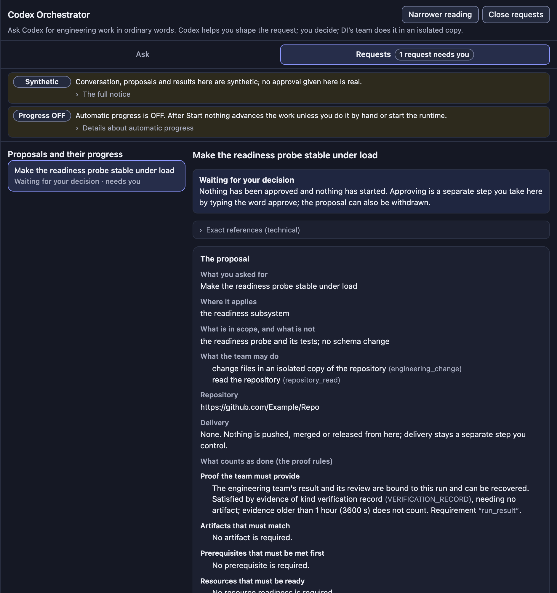 | 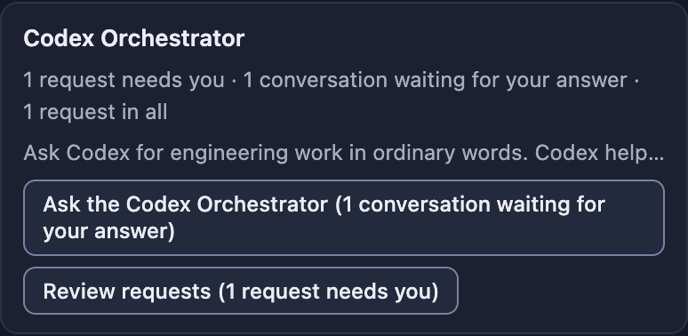 |
| Wider reading puts the list beside the open request where the pane is at least 640 px wide; narrower, the list stacks above it as in ordinary reading. | Each number names its noun, and the line is never cut off. |

These four pictures are synthetic owned-fixture captures from the final package, not owner-supplied captures and not live Mission work; the product says so in the frame. How they were made and which build they come from: [assets/pixel-world/request-workspace-provenance.md](assets/pixel-world/request-workspace-provenance.md). The workspace sits beside the side panel when the window has room (1020 px wide with the side panel shown, 600 px with it hidden) and otherwise covers the window and says so.

This is a **different lane from the Grok Bot workflow above**. It is built on Mission Core and the local request surface; it is not an upgrade of the Grok route and not interchangeable with it, and Grok Bot does not gain this capability. Setup, the approval model, and the limits are in the [Codex Orchestrator guide](https://github.com/TheMickeyDodger/dodging-infinity/blob/main/docs/pixel-agents-office.md#requesting-missions-the-codex-orchestrator).

[Office setup](https://github.com/TheMickeyDodger/dodging-infinity/blob/main/docs/pixel-agents-office.md) · [World presets](https://github.com/TheMickeyDodger/dodging-infinity/tree/main/integrations/pixel-agents/packaging/di/worlds) · [Pixel Agents provenance](https://github.com/TheMickeyDodger/dodging-infinity/blob/main/integrations/pixel-agents/UPSTREAM.md)

## Components and integrations

DI keeps the Mission’s records and operating rules separate from the tools that carry out the work.

| Component | Role |
|---|---|
| **Dodging Infinity** | Mission identity, approvals, state, Runtime progression, evidence, verification, and delivery records. |
| **Grok Bot** | The verified remote conversation interface for Mission deployment, monitoring, updates, and approved delivery. |
| **Codex** | The default Outer Operator for interpreting requests, preparing scoped work, and reasoning about results. |
| **Herdr** | Engineering execution through Supervisor, Lead, Executor, and Reviewer roles. |
| **Pixel Agents office** | Visual observation of recorded Missions, agents, task chains, and review information. |
| **Pi** | An optional Operator session implementation, selected explicitly and using the configured model and provider. |
| **Telegram** | An additional remote transport with its own setup and operating commands. |
| **Dots** | Optional access through a local Codex task; a dedicated integration is part of the broader interface direction. |
| **GitHub** | A source repository, collaboration surface, and delivery destination for engineering work. |

Herdr roles can use the model CLIs supported by their configured presets. The Operator boundary also allows an explicit choice of runtime. Automatic selection of the best model for each task is part of the project’s future direction.

[Grok Bot](https://github.com/TheMickeyDodger/dodging-infinity/blob/main/docs/grok-bot.md) · [Operator sessions](https://github.com/TheMickeyDodger/dodging-infinity/tree/main/operator_session) · [Telegram](https://github.com/TheMickeyDodger/dodging-infinity/blob/main/docs/operations.md#9-telegram-remote-control)

## Get started

### Requirements

The established host for the full remote workflow is **macOS**. Linux is also covered by core development and CI. Keep the host and the relevant services available while Missions run.

| Requirement | Used for |
|---|---|
| **Python 3.9+** | DI’s core Runtime and command-line tools. The core uses the Python standard library. |
| **Git** | Repository workspaces and delivery. |
| **[Herdr](https://github.com/herdrdev/herdr#install)** | Engineering execution. Install it and make the `herdr` command available on your path. |
| **[Codex CLI](https://github.com/openai/codex)** | The default Outer Operator and Codex-backed roles. Authenticate it before use. |
| **[Claude Code](https://code.claude.com/docs/en/overview)** | Claude-backed engineering roles. Authenticate it for presets that use Claude. |
| **Node.js 20+ and npm** | The optional Pixel Agents office. |
| **Grok Bot connector access** | The featured remote interface. |
| **Repository credentials** | Access to private repositories and authorized pushes. |

[Detailed requirements](https://github.com/TheMickeyDodger/dodging-infinity/blob/main/docs/operations.md#1-requirements)

### 1. Install the DI commands

After installing and authenticating the required tools:

```bash
git clone https://github.com/TheMickeyDodger/dodging-infinity.git
cd dodging-infinity
bash scripts/install.sh
export PATH="$HOME/.local/bin:$PATH"
herdctl safety-install
```

The installer adds **`herdctl`**, **`codexgw`**, **`tgop`**, **`dirun`**, and **`grokbot`** to `~/.local/bin`. Add that directory to your shell profile to keep the commands available in new terminals.

Model tools, credentials, remote configuration, and the office build are configured separately in the current setup.

### 2. Prepare a repository for local engineering

From the repository you want to work on:

```bash
cd /absolute/path/to/your-repository

herdctl init \
  --alias my-repo \
  --test-command 'npm test && npm run build'

herdctl doctor --repo my-repo
herdctl bootstrap --repo my-repo
herdctl health --repo my-repo
```

Replace the path and verification command with those appropriate to your project. The example uses a JavaScript project’s test and build commands.

To dispatch a local Herdr engineering task:

```bash
herdctl task \
  'Investigate the failing test, explain the cause, fix it, and verify the result. Do not commit.' \
  --repo my-repo

herdctl status --repo my-repo
herdctl observe --repo my-repo --json
```

This local path is useful for preparing a repository and working directly with its engineering team. Grok Missions use the DI Runtime workflow described next.

### 3. Connect Grok Bot

The remote setup connects three parts: the **Grok connector**, the **local DI endpoint**, and the **DI Runtime**.

Create the protected state directories and credentials described in the [Grok setup guide](https://github.com/TheMickeyDodger/dodging-infinity/blob/main/docs/grok-bot.md#running-the-endpoint-locally). Put the Runtime configuration inside the workflow-store directory it names:

```json
{
  "schema": "dodging-infinity.runtime-config.v1",
  "control_repository": "/absolute/path/to/dodging-infinity",
  "workflow_store": "/absolute/path/to/workflow-store"
}
```

Use canonical absolute paths. The workflow store belongs outside the DI checkout, with directory permissions `700` and configuration-file permissions `600`.

Start the Runtime in one terminal:

```bash
dirun \
  --runtime-config /absolute/path/to/workflow-store/runtime-config.json \
  run
```

Create the `mission-workspaces` directory outside your repositories before starting the endpoint. Then start the endpoint in another terminal, using the same workflow-store directory:

```bash
grokbot \
  --state-dir /absolute/path/to/grok-state \
  --repository /absolute/path/to/dodging-infinity \
  --control-repo /absolute/path/to/dodging-infinity \
  --workflow-store /absolute/path/to/workflow-store \
  --workspace-repository /absolute/path/to/your-repository \
  --workspaces-root /absolute/path/to/mission-workspaces \
  serve \
  --port 8765 \
  --auth-token-file /absolute/path/to/bearer-token
```

Expose the loopback endpoint through the configured HTTPS forwarder, register its `/mcp` URL and bearer credential in Grok’s custom connector, and enable the documented local-command capability for approval steps. Keep the Runtime and endpoint running.

You can then propose, approve, monitor, and update Missions through Grok, review the results, and authorize delivery. Grok-only operation uses the Runtime’s own configuration and does not require Telegram credentials.

[Complete Grok configuration](https://github.com/TheMickeyDodger/dodging-infinity/blob/main/docs/grok-bot.md) · [Runtime configuration](https://github.com/TheMickeyDodger/dodging-infinity/blob/main/docs/operations.md#running-a-runtime-without-telegram) · [HTTPS tunnel](https://github.com/TheMickeyDodger/dodging-infinity/blob/main/docs/tunnel.md)

### 4. Open the visual office

The office has its own installation and build inside the DI checkout:

```bash
cd /absolute/path/to/dodging-infinity
cd integrations/pixel-agents

git config --get core.hooksPath

HUSKY=0 SCARF_ANALYTICS=false DO_NOT_TRACK=1 \
  npm ci --foreground-scripts --no-audit --no-fund --no-update-notifier

git config --get core.hooksPath
npm run build
```

The two Git hook-path readings should match. An unset value prints nothing and returns status 1. The environment flags skip Husky setup and opt out of Scarf analytics.

From the DI checkout root, register the stores used by your running setup in a dedicated office catalog:

```bash
cd /absolute/path/to/dodging-infinity

python3 dicatalog.py register \
  --registry /absolute/path/to/office-catalog \
  --source-id mission_core \
  --kind mission_core \
  --store-dir /absolute/path/to/mission-core-store \
  --producer dodging-infinity

python3 dicatalog.py register \
  --registry /absolute/path/to/office-catalog \
  --source-id workflows \
  --kind workflow_store \
  --store-dir /absolute/path/to/workflow-store \
  --producer dodging-infinity

python3 dicatalog.py sources \
  --registry /absolute/path/to/office-catalog
```

The Mission Core store contains `missions.json`; the WorkflowStore contains `workflows.json`. Use the real stores from your setup. The [source-registration guide](https://github.com/TheMickeyDodger/dodging-infinity/blob/main/docs/pixel-agents-office.md#register-the-sources) explains how to identify them.

Then add the DI-native task source, so the teams working in a repository you prepared with `herdctl init` (step 2) need no per-team source configuration; the office shows the current verified roles of those teams, within the limits it discloses (a team can still be absent, for example when its session cannot be bound, its records are stale, a source is refused or unreadable, or the runtime listing is over its fixed capacity):

```bash
python3 dicatalog.py task-source \
  --registry /absolute/path/to/office-catalog \
  --ensure
```

It registers the directory where `herdctl init` keeps its repository list (`~/.config/dodging-infinity`; pass `--store-dir` for another) as the `task_native` source `di_herdr_tasks`, and writes only the registry. Running it again changes nothing, and that store already registered under another id counts as done. For an existing office catalog this command is the whole adoption step: it never rewrites or repairs an existing entry, and a refusal names its problem and the next step, leaving the registry as it was. A write failure (permission, disk, I/O) is a different outcome: it is reported as `failed` with exit 5 after the registry is read again, and when the replacement had already landed it is reported as `registry_write_unconfirmed` (not rolled back, durability not confirmed) rather than as unchanged. Without `--ensure` it only reports, as one JSON line, whether the source is registered and, if not, the exact command to run. When the office reads `Runtime agents: not_applicable (task_native_source_not_registered)`, this is the command that fixes it.

Start the catalog bridge from the DI checkout root:

```bash
python3 dicatalog_http.py \
  --registry /absolute/path/to/office-catalog \
  --discovery-file /absolute/path/to/office-bridge/backend-discovery.json \
  --discover-roots \
  --contract-version 2
```

In another terminal, also from the checkout root, start the office:

```bash
node integrations/pixel-agents/dist/di-cli.js \
  --state-dir /absolute/path/to/office-state \
  --backend-discovery /absolute/path/to/office-bridge/backend-discovery.json \
  --contract-version 2
```

Both processes use the same discovery file and contract version. Version 2 includes task-chain and review information.

Install the **`pixel`** launcher once, from the DI checkout root:

```bash
cd /absolute/path/to/dodging-infinity

mkdir -p "$HOME/.local/bin"
ln -s "$PWD/integrations/pixel-agents/packaging/di/pixel" \
  "$HOME/.local/bin/pixel"

export PATH="$HOME/.local/bin:$PATH"
```

Keep `~/.local/bin` on your shell’s path as described in step 1. If the launcher is already installed, reuse that installation.

Save the office location so the launcher remembers it across terminal sessions:

```bash
PIXEL_CONFIG_DIR="${XDG_CONFIG_HOME:-$HOME/.config}/pixel-agents-di"
mkdir -p "$PIXEL_CONFIG_DIR"

cat > "$PIXEL_CONFIG_DIR/pixel.json" <<'JSON'
{
  "state_dir": "/absolute/path/to/office-state"
}
JSON
```

Use the same absolute `state_dir` passed to the office process. An existing `PIXEL_AGENTS_DI_STATE_DIR` environment setting takes precedence over this file.

**From then on, with the catalog and office running, just type:**

```bash
pixel
```

The launcher opens your office in the default browser. The roadmap extends this everyday command with automatic presentation startup or reconnection and clearer connection diagnostics.

To load the world shown above, export any layout you want to keep, choose **Settings → Import Layout (paste JSON)**, paste the contents of [**`living-metropolis.json`**](https://github.com/TheMickeyDodger/dodging-infinity/blob/main/integrations/pixel-agents/packaging/di/worlds/living-metropolis.json), and reload the page.

[Office installation and launch](https://github.com/TheMickeyDodger/dodging-infinity/blob/main/docs/pixel-agents-office.md) · [Launcher instructions](https://github.com/TheMickeyDodger/dodging-infinity/blob/main/docs/pixel-agents-office.md#the-pixel-launcher)

## How DI keeps the work accountable

- **The Mission defines the scope.** Objectives, constraints, acceptance criteria, and approvals belong to a specific version of the work.
- **Evidence has a source.** Test results, review decisions, research findings, and artifacts remain connected to the claims they support.
- **Review is independent.** The engineering Reviewer can reject a change and require another implementation pass.
- **Uncertainty stays visible.** Missing evidence, stale observations, and blockers remain explicit until they are resolved.
- **Delivery is deliberate.** Commit and push decisions are recorded for the work being delivered.

These principles apply across the technical work DI supports, from a repository fix to a sustained research project.

[Architecture](https://github.com/TheMickeyDodger/dodging-infinity/blob/main/docs/architecture.md) · [Security](https://github.com/TheMickeyDodger/dodging-infinity/blob/main/SECURITY.md) · [Operator rules](https://github.com/TheMickeyDodger/dodging-infinity/blob/main/AGENTS.md)

## Where DI is going


The goal is a system you can direct in ordinary language, leave working through supported interruptions, and return to with a clear account of what happened. You should be able to move between your phone, the Operator, and the office while following the same Missions, teams, decisions, and evidence.

This direction follows **roadmap v320, dated October 17, 2026**. The diagrams below show the **intended architecture as that roadmap is completed**. Development builds on the verified Grok workflow and existing DI, Herdr, and Pixel capabilities, with each addition demonstrated through its own acceptance scenarios.

### The six main stages

| Stage | What it brings to DI |
|---|---|
| **R1 · Dependable integrated operation** | Reliable unattended work, recovery, shared attention, evidence, reusable Mission memory, and a repeatable research workflow. Complete demonstrated gaps across the combined system. |
| **R2 · Adaptive teams** | Select qualified models for individual assignments, compare frontier and local execution, and escalate through a recorded handoff that preserves the work. |
| **R3 · Dots alongside Grok** | Use either interface to interact with the same Missions, decisions, progress, results, and delivery process. |
| **R4 · An everyday visual Mission world** | Dependable `pixel` launch, an operational overview, a reception inbox, distinct team headquarters, evidence browsing, and richer atmosphere. Validate the office integration in CI. |
| **R5 · Guided installation and product packaging** | One installation command, guided account and repository setup, a first verified Mission, useful diagnostics, and repeatable updates and recovery on another supported Mac. |
| **R6 · A measured durability decision** | Evaluate whether DBOS would improve recovery and operations. Adopt, defer, or retain the current design based on evidence. This is the last main decision. |

R1 also covers the selected document, operations, browser, media, and communication workflows; reusable context and verification recipes; capacity and priority controls; and specific security, Git, migration, and operational improvements. Existing tools and working behavior remain the starting point.

### Target architecture: one Mission system

Grok and Dots converge on the same Codex Operator and DI contracts. The visual world reads those records and, as desktop controls are added, routes actions through DI’s established authorization APIs.

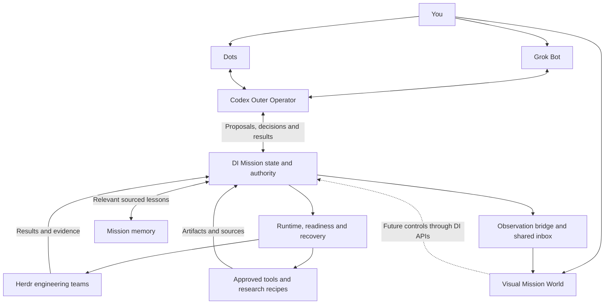

**DI remains responsible for Mission identity, scope, authority, state, and delivery records.** Codex remains the Outer Operator. Herdr owns bounded engineering execution. Research and other selected capabilities use suitable existing tools and reviewed recipes, with results tied back to the Mission.

The shared inbox carries questions, blockers, approval requests, failed verification, results ready for review, and delivery decisions. Grok, Codex, and the office reception desk should explain the same pending item and its route for action. Dots joins those shared contracts as its integration is completed.

Work stays on supported local execution environments unless a selected workload needs another host or specialized capability. Expansion to additional machines must preserve identity, ownership, authority, evidence, and recovery. The visual presentation continues to use a thin DI bridge as its renderer and packaging evolve.

### Target engineering: a team chosen for the assignment

A Mission may contain very different kinds of work. A small interface change, a numerical algorithm, and an authorization change can require different models, tools, and levels of review.

The Supervisor defines the work and role requirements. A versioned selection policy chooses among approved, qualified configurations. Herdr launches and coordinates the resulting team.

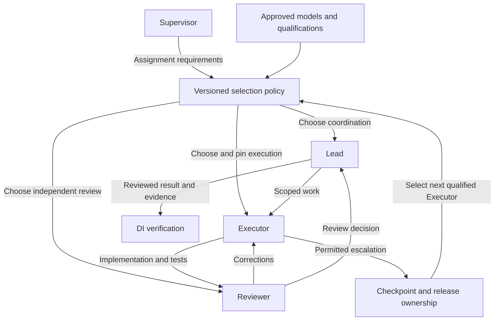

Selection considers the assignment’s required tools, context, correctness risks, permitted providers, available resources, and demonstrated results. The selected model stays fixed for its assignment. A change of model becomes an explicit reassignment with a recorded reason. If no qualified option is available, the assignment waits or surfaces a specific decision.

Escalation carries the exact workspace, objective, findings, attempted fixes, failed checks, logs, remaining budget, and applicable authority. The source relinquishes ownership before the destination continues, preserving one writer and the same Mission identity.

The rollout starts with a controlled **frontier-versus-local Executor comparison**, holding the Supervisor, Lead, Reviewer, interface, and checks fixed. Executor selection follows; a hybrid local-to-frontier path follows verified handoffs. Adaptive Lead and Reviewer selection then receive their own measured trials. Defaults are chosen by verified quality, missed defects, correction rounds, elapsed time, human interruptions, and total cost.

Model selection and handoff events become visible in Mission observations and the office. Available records should explain which model was requested, which identity was confirmed, why it was chosen, and whether work was transferred.

### Target workflow: continuity, evidence, and delivery

Reliable operation carries the Mission through interruptions, decisions, review, and delivery while retaining the information needed to continue correctly.

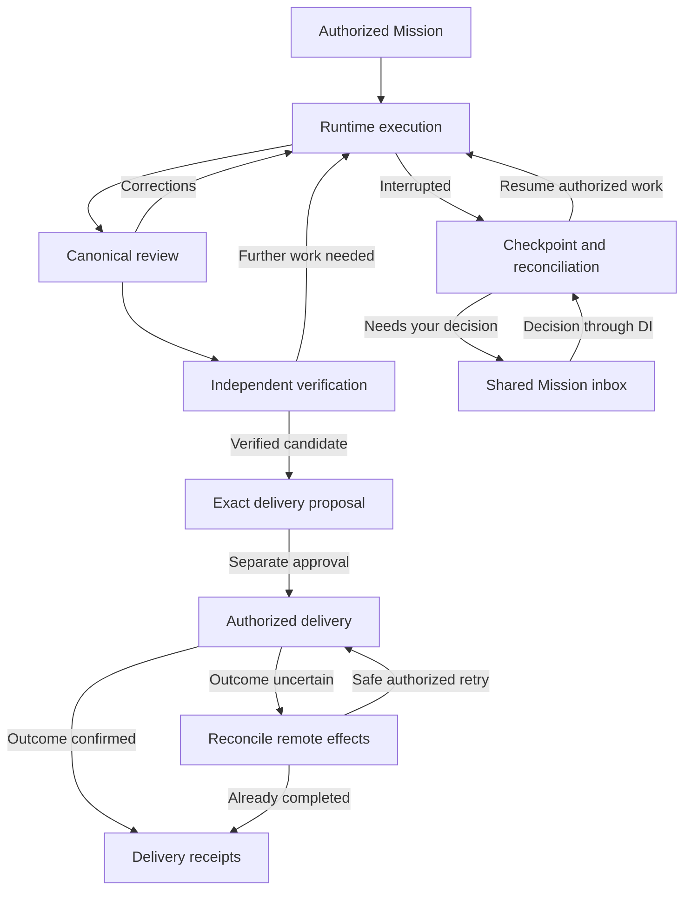

The runtime should explain why work stopped, what remains authorized, which checkpoints exist, and what can happen next. Recovery reconciles uncertain effects before retrying so a reconnect does not create a second dispatch or duplicate delivery.

Mission memory preserves useful repository knowledge, engineering decisions, and recovery lessons with sources and their applicable context. A later team can assess a lesson’s freshness and use it to avoid repeating a solved problem. Historical approvals remain records of earlier decisions; new work follows its applicable authorization.

The delivery lane prepares the candidate, documentation, and evidence for an exact decision tied to the repository, branch, operations, and destination. Valid approval can be reused within its binding, avoiding unnecessary repeated decisions. Commit, push, and PR receipts remain inspectable. Selected merge, release, deployment, publishing, or communication workflows retain their own supported routes and applicable approvals.

Research builds on the work DI already supports. The next milestone formalizes a repeatable research Mission with permitted sources, a useful report, supported claims, and an explicit verification rubric.

### The office becomes an everyday operating view

The world should help you answer three practical questions: **What is happening? What needs me? What did the team produce?**

| Planned experience | What you will be able to do |
|---|---|
| **Dependable `pixel` launch** | Open or reconnect to the presentation with one command. Get a specific remedy when the catalog or runtime is unavailable. Reopening the viewer preserves the running work. |
| **Reception desk and shared inbox** | Find questions, blockers, approval requests, failed checks, and results awaiting review in one consistent attention view. |
| **Daily operational overview** | Distinguish running, waiting, blocked, disconnected, and unknown states. Inspect runtime health, observation freshness, checkpoints, and actionable failure explanations, with a practical list alongside the world. |
| **Distinct Mission headquarters** | Give concurrent teams identifiable homes, readable labels, simple Mission switching, and a “find this team” camera action. Follow observed team membership and activity. |
| **Evidence library and Mission inspector** | Open artifacts and inspect assignments, dependencies, review findings, independent verification, and delivery receipts. See the source and freshness of the records. |
| **Visible model choices and handoffs** | Inspect recorded role selections, confirmed model identities where available, and the reasons for an escalation. |
| **Richer atmosphere** | Add day/night lighting, seasons, regional weather, and moving traffic while preserving responsive navigation, readable labels, reduced-motion support, and persistent preferences. |

The office remains a view over DI’s records. Future Mission controls use the same action and approval contracts as the other interfaces. Decorative residents and atmospheric effects retain their presentation role.

Office validation expands to lockfile installation, type checking, lint, server and UI tests, a production build, and browser checks through the actual catalog connection and Mission/agent rendering. These checks should catch an integration break during PR validation, alongside the existing core checks.

### Installation becomes one guided experience

The intended first-run experience starts with **one installation command from this README**. It detects the supported Mac environment, coordinates the required components, offers a recommended configuration, and guides the user through repository selection and account connections.

The installer then prepares DI and the selected office, checks their communication, explains what is running, and guides a small first Mission through approval, execution, and a verified result. Required account sign-in and operating-system prompts remain part of that guided experience. Advanced configuration and large local-model downloads remain optional.

Everyday operation adds coherent setup/resume, start, status, diagnosis, and update commands. A failed dependency, unavailable service, or configuration problem should come with a specific remedy. Supported upgrades and recovery preserve configuration, evidence, and authority on a second installation as well as the original host.

### The next reliability milestone

The daily-use track starts with execution reliability, dependable office launch, and the shared inbox. The operational overview, team headquarters, and evidence browsing build on those foundations. Delivery, reusable lessons, and the repeatable research workflow follow, with atmospheric upgrades after daily operation is dependable.

Its integrated acceptance exercise follows one bounded Mission through:

1. A request through Grok, with the same Mission and its bound team visible in Pixel.
2. A permitted interruption and supported recovery that preserve identity, work, and evidence.
3. A shared human decision where needed, followed by canonical review and independent verification.
4. Result and artifact inspection, then exact delivery approval and a PR with receipts.
5. Retries, reconnections, and viewer reopening that leave one execution and one intended delivery.

Adaptive team trials and Dots integration retain their own acceptance gates. Office, CI, and installer work can progress against stable shared contracts.

### Further capabilities, evaluated through real workloads

The roadmap also preserves a set of focused investigations. Each should earn its place through a useful result and measured improvement.

| Evaluation | Potential contribution |
|---|---|
| **Specialist advisor consultations** | Bounded advice on difficult designs while preserving the team’s canonical review and verification. |
| **External Herdr / Connecting the Machines** | Execution on another host when a real workload needs its tools or resources, with ownership and disconnect recovery demonstrated. |
| **OpenEvolve** | Algorithm improvement against a fixed correctness evaluator, held-out cases, and an explicit compute budget. |
| **TLA+/TLC or Lean** | Formal analysis of a bounded lifecycle behavior or mathematical property, with explicit assumptions and checkable artifacts. |
| **OR-Tools** | Constraint-based planning for work with resource limits, dependencies, and scheduling requirements. |
| **angr** | Authorized binary or firmware analysis, with findings reproduced in actual execution. |
| **LAMMPS or an appropriate scientific toolchain** | Reproducible simulation against reference cases before extending to new scientific candidates. |
| **TypeSafe AI / Jev** | A measured evaluation where a specific decision or verification bottleneck remains. |

Pi may support selected execution configurations where its adapters fit the required models and tools. LiteLLM can be evaluated if multiple compatible local or API endpoints justify an inference gateway. Reviewed pstack-derived recipes can support recall, explanation, and verification. These choices remain separate from adopting another orchestration system.

The final durability review asks whether DBOS improves demonstrated recovery or operating needs enough to justify a migration. Keeping the existing execution substrate remains a valid outcome.

[Project roadmap documentation](https://github.com/TheMickeyDodger/dodging-infinity/blob/main/docs/roadmap.md)

## Documentation

| Guide | What it covers |
|---|---|
| [Architecture](https://github.com/TheMickeyDodger/dodging-infinity/blob/main/docs/architecture.md) | Mission structure, system responsibilities, evidence, and execution boundaries. |
| [Operations](https://github.com/TheMickeyDodger/dodging-infinity/blob/main/docs/operations.md) | Requirements, repository setup, commands, Runtime configuration, and remote operation. |
| [Grok Bot](https://github.com/TheMickeyDodger/dodging-infinity/blob/main/docs/grok-bot.md) | Connector setup, endpoint configuration, Mission interaction, and delivery approvals. |
| [HTTPS tunnel](https://github.com/TheMickeyDodger/dodging-infinity/blob/main/docs/tunnel.md) | Making the local endpoint available to the remote connector. |
| [Pixel Agents office](https://github.com/TheMickeyDodger/dodging-infinity/blob/main/docs/pixel-agents-office.md) | Build, source registration, launch, world presets, and the browser interface. |
| [Operator protocol](https://github.com/TheMickeyDodger/dodging-infinity/blob/main/OPERATOR_PROTOCOL.md) | Preparing work, coordinating with Herdr, inspecting results, and delivery. |
| [Roadmap](https://github.com/TheMickeyDodger/dodging-infinity/blob/main/docs/roadmap.md) | Planned capabilities and acceptance criteria. |
| [Contributing](https://github.com/TheMickeyDodger/dodging-infinity/blob/main/CONTRIBUTING.md) | Development setup, testing, and contribution expectations. |
| [Security](https://github.com/TheMickeyDodger/dodging-infinity/blob/main/SECURITY.md) | Security boundaries and reporting guidance. |
| [Changelog](https://github.com/TheMickeyDodger/dodging-infinity/blob/main/CHANGELOG.md) | Release history. |

## Contributing

Contributions are welcome across the orchestration core, integrations, documentation, tests, and visual office. Start with [CONTRIBUTING.md](https://github.com/TheMickeyDodger/dodging-infinity/blob/main/CONTRIBUTING.md), and read the repository’s [operator rules](https://github.com/TheMickeyDodger/dodging-infinity/blob/main/AGENTS.md) before initiating automated work.

For a proposed change, make the problem, scope, expected behavior, and verification clear. The core and office have separate dependency and validation requirements, described in their respective guides.

## License and acknowledgments

Dodging Infinity is licensed under **Apache 2.0**. See [LICENSE](https://github.com/TheMickeyDodger/dodging-infinity/blob/main/LICENSE).

The vendored Pixel Agents office retains its own notices: MIT-licensed code, character art derived from CC0 sources, and a font under the SIL Open Font License 1.1. See the [Pixel Agents provenance and licensing guide](https://github.com/TheMickeyDodger/dodging-infinity/blob/main/integrations/pixel-agents/UPSTREAM.md#licensing).

The linked research and upstream software projects retain their own licenses and attribution requirements.


*The next Mission is yours. It’s hero time!*
